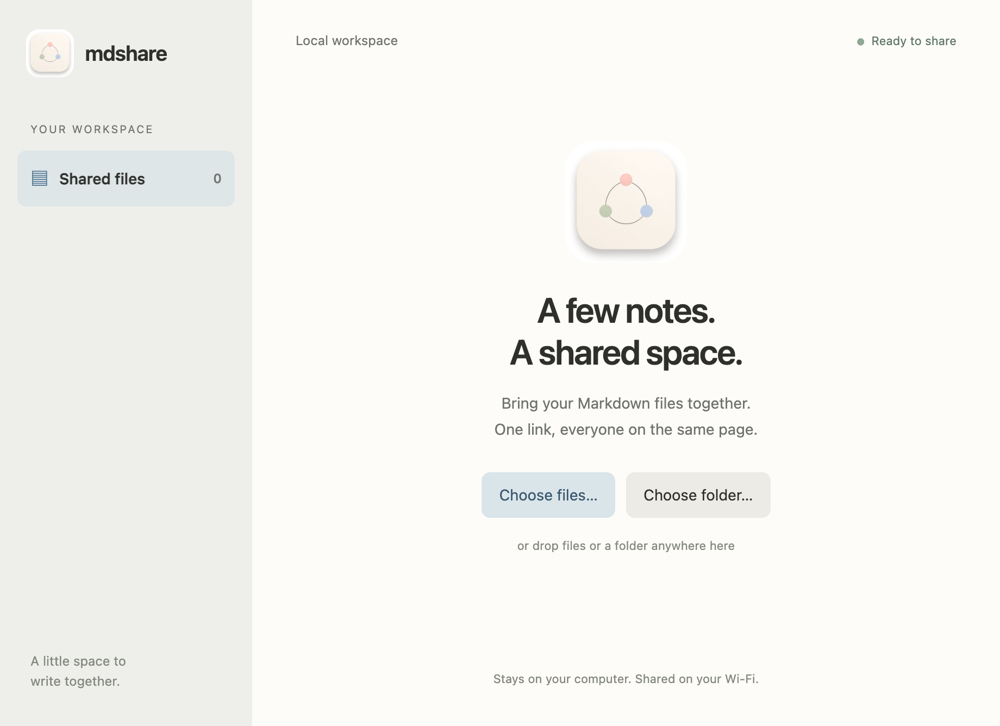
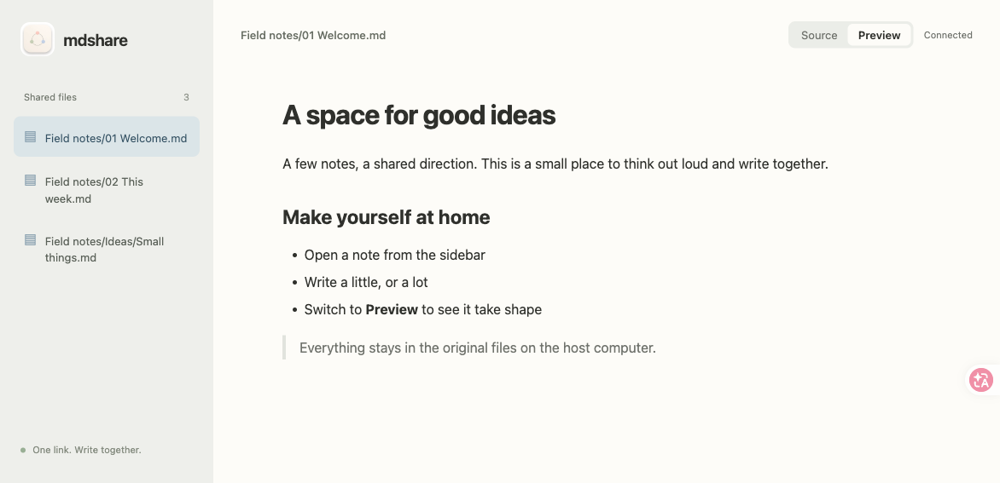
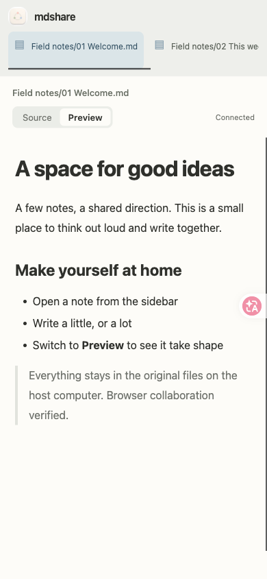

# Issue #2 verification

Implemented and checked on the Mac mini (`Macmini9,1`), on branch `ui/things-multifile`.

## Automated checks

`npm test`: **60 tests, 59 passed, 0 failed, 1 skipped**, using Electron's embedded Node. The existing skip is xattr/Finder-tag preservation, which still requires the native metadata addon.

Seven new integration tests cover independent per-file CRDTs and awareness, convergence within a file, original-path writeback with BOM/CRLF/mode preservation, stop/flush/token revocation across all files, nested folder selection and deduplication, exclusion of hidden files and symlinks, invalid selections and limits, session-wide freeze, escaped file labels and opaque file routing, stale epochs with old file IDs, and replacing a share without losing pending writes.

`git diff --check` and JavaScript syntax checks passed.

## UI checks

- Ran the actual Electron main process in an isolated temporary user-data directory. A fixture supplied paths at the native dialog boundary; actual preload IPC, window rendering, core host, server and QR generation ran unchanged. Verified idle screen, choosing two files, share link and QR display, stopping, choosing a folder with a nested file, and stopping again.
- Used two real Chromium tabs through ego-browser. Edited the first file and observed its live preview update in the other tab; edited a second file, switched back, and checked that only the intended original paths contained each edit. Only one CodeMirror instance remained after switching.
- Changed a third file externally. Both tabs became read-only; switching to another file preserved read-only state. Stopped the host and verified both tabs displayed the ended screen, removed their editors and disabled file selection.
- Inspected desktop and 390 × 844 mobile layouts. Mobile file navigation scrolls horizontally.

These checks used the local Mac mini; they do not claim a physical second-device Wi-Fi test or Safari validation.

## Screenshots

